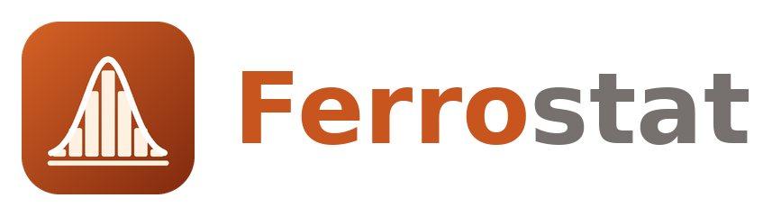

<p align="center">
  <a href="https://ferrostat.github.io/ferrostat-engine/#donate"></a>
  &nbsp;
  <a href="https://ferrostat.github.io/ferrostat-engine/#donate"></a>
</p>

<p align="center"><b>Ferrostat is free software built in the open. If it saves you a licence fee or an afternoon, please consider a donation — it keeps the project going.</b></p>

<p align="center"></p>

# Ferrostat

A statistical computing engine written in Rust. Ferrostat provides an environment for data manipulation, statistical estimation, and graphics, driven by a do-file command language compatible with the widely used `.do`/`.dta` ecosystem. It comes in three front ends sharing one engine: a terminal (CLI), a desktop application, and a browser version compiled to WebAssembly.


## Support Ferrostat ❤️

Donations fund development time, CI runners and code signing for the desktop builds. Every amount helps.

| | Bitcoin (native SegWit) | Ethereum (and ERC-20) |
|---|---|---|
| **Address** | `bc1qapwnysw6djg0zscl7qlys5ed658xfna07pg4v4` | `0xbF5a5803a4931de99D40f8cec7bE6cd04828a2F8` |
| **On a computer** | [**Copy address or open your wallet**](https://ferrostat.github.io/ferrostat-engine/#donate) | [**Copy address or open your wallet**](https://ferrostat.github.io/ferrostat-engine/#donate) |
| **On a phone** |  |  |

```
bc1qapwnysw6djg0zscl7qlys5ed658xfna07pg4v4
```
```
0xbF5a5803a4931de99D40f8cec7bE6cd04828a2F8
```


[](https://github.com/ferrostat/ferrostat-engine/actions/workflows/ci.yml)
[](https://github.com/ferrostat/ferrostat-engine/releases/latest)
[](https://ferrostat.github.io/ferrostat-engine/app/)
[](https://www.rust-lang.org)
[](LICENSE)

---

---

## Table of Contents

- [Support Ferrostat](#support-ferrostat-️)
- [Overview](#overview)
- [Features](#features)
- [Quick Start](#quick-start)
- [Front Ends](#front-ends)
- [Installation](#installation)
- [Command Reference](#command-reference)
- [Architecture](#architecture)
- [Data Formats](#data-formats)
- [Graphics](#graphics)
- [Testing and Validation](#testing-and-validation)
- [Known Limitations](#known-limitations)
- [Provenance](#provenance)
- [Contributing](#contributing)
- [License](#license)

---

## Overview

Ferrostat runs existing analysis scripts unchanged: it reads and writes `.dta` files, executes `.do` files (macros, loops, programs), fits the common econometric models, and exports tables (Excel, tab-delimited), logs (SMCL/text) and graphs (PNG/SVG/PDF). It is designed for:

- **Reproducible research** — batch scripts with deterministic execution on Linux, Windows and macOS
- **Data archaeology** — reading legacy `.dta` files (formats 102–119) and fixed-format text (`infile`, `infix` dictionaries) on any platform
- **Statistical education** — every algorithm is readable Rust
- **Embedding** — use the engine and its datasets from Rust applications
- **Zero-install teaching** — the browser version runs entirely client-side; data never leaves the page

---

## Features

### Language
- Macros: `` `local' ``, `$global`, `` `=exp' ``, `` `:extended function' ``, `` `++i' ``, nested macros, compound quotes
- Control flow: `foreach` (in/of local/global/varlist/newlist/numlist), `forvalues`, `while`, `if`/`else if`/`else`, `continue`, `break`
- Prefixes: `quietly`, `noisily`, `capture` (sets `_rc`), `by`/`bysort` (group-aware `_n`, `_N`, subscripts), `xi:`, `frame name:`, `bootstrap:`, `simulate:`, `permute:`, `collect:`, `svy:`, `mi estimate:`
- Programs: `program define … end` with `syntax`, `args`, `tokenize`, `gettoken`, `marksample`, `tempvar`/`tempname`/`tempfile`, `return`/`ereturn`
- Stored results `r()`, `e()`, `c()`, `_b[]`, `_se[]`, scalars and a matrix language (`J()`, `I()`, `diag()`, `inv()`, joins, subscripts, `accum`, `symeigen`, `mkmat`/`svmat`)
- Command abbreviations (`gen`, `su`, `reg`, `tab`, …), varlist wildcards and ranges, factor variables (`i.`, `ib#.`, `c.`, `#`, `##`) and time-series operators (`L.`, `F.`, `D.`, `S.`)
- `#delimit ;`, `///` continuation, `//` and `/* */` comments, `do`/`run`/`include`, `log using`, `set rmsg on`, `cls`
- User-written `egen` functions (`program _gname`), `notes`, `char`, `label language`, `timer`
- Error messages suggest the closest command, variable or option ("did you mean regress?")
- `ferrostat --check file.do` (and `lint using`) checks do-files without running them: unbalanced blocks, unterminated strings, unknown commands, undefined locals

### Expressions
Missing values sort above all numbers (`.` < `.a` < … < `.z`), arithmetic with missing yields missing, and logical tests follow the usual rules (`x > 5` is true for missing `x`). Around 200 functions: mathematics, distributions (`normal`, `invnormal`, `t`/`ttail`, `chi2`/`chi2tail`, `F`/`Ftail`, `binomial`, `poisson`, `gammap`, `ibeta`, inverses), random numbers (`runiform`, `rnormal`, … with `set seed`), strings (`substr`, `strpos`, `subinstr`, `regexm`, `ustrregexra`, `word`, `strtrim`, …), dates (`mdy`, `date`, `clock`, `year`, `dofm`, `age`, `datediff`, `birthday`, `%td`/`%tc`/`%tm`/`%tq` formats), programming (`cond`, `inlist`, `inrange`, `missing`, running `sum()`).

### Data management
`generate`/`replace` (storage types, sequential evaluation), `egen` (~35 functions), `drop`/`keep`, `rename` (groups, wildcards, `lower`/`upper`), `clonevar`, `browse`/`edit` (no-ops in batch mode), `order`, `sort`/`gsort`, `label` (define/values/variable/data/list), `encode`/`decode`, `destring`/`tostring`, `recode`, `mvencode`/`mvdecode`, `split`, `format`, `compress`, `recast`, `collapse` (all statistics), `contract`, `expand`, `fillin`, `reshape long|wide` (numeric and string `j`), `merge 1:1|m:1|1:m|m:m` (with `keep()`, `keepusing()`, `update`, `replace`, `assert()`), `append`, `joinby`, `cross`, `xpose`, `sample`, `duplicates`, `isid`, `levelsof`, `preserve`/`restore`, `input`, `infile`/`infix` (free format and dictionaries), `separate`, `set obs`, `tsset`/`xtset`; frames: `frame create|change|copy|put|drop|rename|dir|reset`, `frame name: cmd`, `cwf`/`pwf`, `frlink`, `frget`, `frval()`.

### Statistics
| Area | Commands |
|------|----------|
| Descriptive | `summarize` (incl. `detail`, weights), `proportion`, `distinct`, `mdesc`, `winsor2`, `tabulate` (one/two-way, `chi2`, `lrchi2`, `exact`, `V`, `gamma`, `taub`, `generate()`), `tab1`, `tab2`, `tabstat`, `table` (current and legacy `contents()` syntax), `dtable`, `correlate`, `pwcorr`, `spearman`, `centile`, `mean`, `total`, `ci`, `codebook`, `misstable` |
| Tests | `ttest` (one-sample, paired, by-group, unequal/Welch), `prtest`, `sdtest`, `ranksum`, `signrank`, `signtest`, `kwallis`, `oneway`, `ksmirnov`, `swilk`, `hausman` |
| Linear models | `regress` (robust, HC2/HC3, cluster, `fw`/`aw`/`pw`/`iw`), `anova`, `areg`, `qreg`, `rreg`, `mvreg`, `manova`/`manovatest`, `ivregress 2sls`/`liml`/`gmm` (`wmatrix()`, `igmm`; `estat firststage`, `estat overid`) |
| Panel | `xtlogit`, `xtprobit`, `xtpoisson`, `xtnbreg` (re by adaptive quadrature, fe, pa), `xtgls`, `xtpcse`, `xtabond`, `xtdpdsys`, `xtabond2`, `xttest0`, `xttest3`, `xtserial`, `xtcsd`, `xtreg` (`fe`, `re`, `be`, cluster), `xtivreg` (`fe`, `be`, `fd`, `re` with G2SLS or `ec2sls`), `xtivreg2` (`fe`, cluster; Kleibergen–Paap and Cragg–Donald identification tests with Stock–Yogo critical values, Hansen J, C endogeneity test), `xtpmg` (PMG, MG; Pesaran CD test) |
| Nonlinear | `logit`, `logistic`, `probit`, `cloglog`, `poisson`, `nbreg`, `zip`, `zinb`, `ologit`, `oprobit`, `mlogit`, `tobit`, `glm` (6 families, 7 links) |
| Multilevel | `melogit`/`meqrlogit` (random intercepts and independent slopes, nested levels, adaptive Gauss–Hermite quadrature) |
| Resampling | `bootstrap` (and `vce(bootstrap)`, `estat bootstrap` with normal/percentile/BC/BCa intervals), `simulate`, `permute`; replications run in parallel on all cores (`set processors #`) with results independent of the core count, also in the browser |
| Survey data | `svyset` (pweights, strata, multistage with `\|\|`, `fpc()`, `singleunit()`, BRR/jackknife/bootstrap/SDR replicate weights; stored with the data), `svydescribe`, `svymarkout`, `svy:` / `svy brr\|jackknife\|bootstrap\|sdr:` with `mean`, `total`, `ratio`, `proportion`, `tabulate` (one-way, two-way with Rao–Scott corrected Pearson and LR tests), `regress`, `logit`, `logistic`, `probit`, `poisson`, `ologit`, `oprobit`, `mlogit`; Taylor-linearized or replicate-weight variances, `subpop()`, adjusted Wald F, `estat effects` (DEFF/DEFT), `estat sd` |
| Multiple imputation | `mi set wide\|mlong\|flong`, `mi register`/`unregister`, `mi impute regress\|pmm\|logit\|ologit\|mlogit\|poisson\|mvn\|monotone\|chained` (proper Bayesian draws from the session generator), `mi describe`, `mi passive:`, `mi xeq:`, `mi extract`, `mi convert`, `mi rename`, `mi reset`, `mi varying`, `mi misstable`, `mi estimate:` (Rubin's rules, Barnard–Rubin small-sample df, RVI/FMI, equal-FMI model F test), `mi test` |
| Treatment effects | `teffects ra`, `ipw`, `aipw` (binary treatment; ATE, ATET, potential-outcome means; robust M-estimation standard errors) |
| High-dimensional FE | `reghdfe` (multiple absorbed fixed effects, multi-way clustering, singleton dropping, saved FEs), `ppmlhdfe` (Poisson PML with separation detection) |
| Regression discontinuity | `rdrobust`, `rdbwselect`, `rdplot`, `rddensity`, `rdbwdensity`; binned scatter plots with `binscatter` |
| Post-estimation | `predict` (xb, residuals, stdp/stdf/stdr, leverage, rstandard/rstudent, cooksd, pr, n, ir, mu, u/e/xbu, scores), `test`, `testparm`, `lincom`, `margins` (predictive margins, `dydx()`, `at()` with numlists and statistics, `atmeans`, `over()`, `predict()` outcomes; delta-method SEs), `marginsplot`, `contrast` (r./a./ar./g. operators, `@` groups, joint Wald tests, `effects`, `post`), r(table) after every coefficient table, `estimates store/restore/table/stats`, `estat ic/vce/hettest/ovtest/vif/summarize/firststage/gof` |
| Spatial | `shp2dta` (ESRI shapefile + dBase import), `spmat contiguity` (queen/rook, row/minmax/spectral normalisation), `spmat lag`, `spmap` (choropleths) |
| Survival | `stset` (id, enter, exit, origin, scale), `stcox` (Breslow, Efron, exact ties; strata, robust, tvc, shared frailty; `estat phtest`, `estat concordance`, `stcurve`), `streg` (exponential, Weibull, Gompertz, log-logistic, lognormal, generalized gamma; PH/AFT; frailty), `sts graph|list|test|generate`, `stsum`, `stci`, `stdescribe`, `stptime`, `stsplit`, `stjoin`, `strate`, `ltable` |
| Time series | `arima` (ARMAX, seasonal, Kalman-filter ML), `newey`, `prais`, `dfuller`, `pperron`, `dfgls`, `corrgram`, `wntestq`, `tssmooth`, `tsfilter` (hp, bk, cf, bw), `var`, `svar`, `varsoc`, `varstable`, `varlmar`, `varnorm`, `vargranger`, `varwle`, `irf` (create, table, graph, ctable, ...), `vec`, `vecrank`, `fcast` |
| ROC | `roctab` (DeLong SE, Lorenz/Gini/Pietra), `roccomp`, `rocgold` (DeLong comparisons), `rocfit` (binormal ML) |
| Mata | `mata`/`mata:` … `end` blocks and `mata:` one-liners (real/string matrices, operators incl. colon ops, subscripts and ranges, typed functions, loops, pointers), `mata describe/drop/clear`, `clear mata`; library (J, I, select, sort, cross, invsym, colsum, mean, tokens, sprintf/printf, …), `st_data/st_sdata/st_view/st_store/st_addvar/st_local/st_global/st_numscalar/st_matrix`… and the `xl()` class (load_book, get_sheets, get_string/get_number, put_*) |
| Python | `python:` one-liners and `python`/`python:` … `end` blocks in a persistent external Python 3 process, `python query/search/which/describe/drop/clear/script/set exec`, `set python_exec`; `sfi` module subset (Data, Macro, Scalar, Matrix, SFIToolkit); not in the browser |
| Other | `kdensity` (8 kernels), `outreg2`-style regression tables, `eststo`/`esttab`/`estout`/`estpost`/`estadd` (stored-model and descriptive tables to screen/RTF/CSV/LaTeX/HTML), `putexcel` (.xlsx, with cell formats: borders, number formats, fonts, fills, alignment, merged cells), `frmttable` (matrix tables to screen/RTF/LaTeX, merge/append/substat/annotate), `unique` |
| Multivariate | `pca`, `factor` (pf, pcf, ipf, ml), `rotate` (varimax, promax, oblimin, ...), `cluster` (hierarchical linkages, kmeans/kmedians, dendrogram, stopping rules), `mds`, `ca`, `mca`, `biplot`, `discrim` (lda, qda, logistic, knn), `candisc`, `canon`, `alpha`, `hotelling`, `mvtest`, `procrustes` |
| Model tools | `lrtest`, `nlcom`, `testnl`, `predictnl`, `pwcompare`, `estat classification/gof`, `lroc`, `lsens`, `jackknife`, `statsby`, `nestreg`, `stepwise`, `ml` (lf/d0–d2 evaluators), `mlexp`, `nl`, `nlsur`, `power`, pk commands |
| Causal inference | `teffects` (ra, ipw, aipw, ipwra, nnmatch, psmatch; multivalued treatments), `tebalance`, `teoverlap`, `didregress`/`xtdidregress`, and natively `csdid`, `drdid`, `did_imputation`, `eventstudyinteract`, `psmatch2`, `cem`, `ebalance`, `synth`, `boottest`, `wyoung` |
| Volatility & state space | `arch`/`garch` (tarch, egarch, aparch, archm; normal/t/ged), `mgarch` (ccc, dcc, vcc, dvech), `arfima`, `sspace`, `ucm`, `dfactor`, `mswitch`, `threshold`, `forecast`, `lpirf` |
| Spatial | `spset`, `spmatrix`, `spregress` (GS2SLS, ML), `spivregress`, `spxtregress`, `estat impact`, `estat moran`, `grmap` |
| Tables | `collect` (tags, `get`, `label`, `style`, `layout`, `preview`, `export` to .docx/.xlsx/.html/.md/.tex/.txt), `table` results stored in collections, `dtable`, `etable` |
| Documents | `putdocx` (.docx: styled paragraphs, text, images, tables from data/matrices/estimates, page breaks, append), `putpdf` (basic PDF), `dyndoc`/`dyntext` (dynamic Markdown with `dd_do`/`dd_display`/`dd_graph`/skip/ignore/remove/include tags to HTML, .docx or text), `markdown`, `html2docx` |
| Bayesian analysis | `bayesmh` (adaptive Metropolis–Hastings, Gibbs blocks, hierarchical priors, random effects, multiple chains), `bayes:` prefix for regression, binary, count, ordinal, survival, multilevel and VAR models, `bayesstats` (summary, ess, ic, grubin, ppvalues), `bayestest`, `bayesgraph`, `bayespredict`, `bayesirf`, `bayesfcast`, `bayesselect` |
| Machine learning | `h2oml gbregress\|gbbinclass\|gbmulticlass\|rfregress\|rfbinclass\|rfmulticlass` (gradient boosting and random forests fitted natively, no cluster needed; early stopping, `cv()`, `validframe()`, hyperparameter grids), `h2omlpredict` (incl. TreeSHAP contributions), `h2omlestat`, `h2omlgraph` (varimp, permimp, pdp, ice, SHAP, ROC, PR, score history), `h2omlselect`, `h2omlgof`, `h2omlest`, `_h2oframe` |
| SEM, IRT, mixtures | `sem` (path syntax, groups and invariance, ml/mlmv/adf, Satorra–Bentler; `estat gof/mindices/teffects/…`), `gsem` (generalized families, multilevel latents, latent classes), `irt` (1pl, 2pl, 3pl, grm, nrm, pcm, gpcm, rsm, hybrid; `irtgraph`), `difmh`, `diflogistic`, `fmm` prefix |
| Lasso & choice models | `lasso`, `elasticnet`, `sqrtlasso` (cv, adaptive, plugin, bic), `ds*`/`po*`/`xpo*` inference, `lassoknots`/`lassocoef`/`cvplot`/`coefpath`; `cmset`, `cmclogit`, `cmmixlogit`, `cmmprobit`, `cmrologit`, `cmroprobit`, `nlogit` |
| Extended regression & causal | `eregress`, `eprobit`, `eoprobit`, `eintreg` and panel `xte*` versions, `etregress`, `etpoisson`, `eteffects`, `hdidregress`, `lateffects`, `cate`, `telasso`, `mediate`, `stteffects` |
| Meta-analysis & model averaging | `meta set/esize/summarize/forestplot/funnelplot/bias/trimfill/regress/mvregress/meregress`; `bmaregress` with `bmastats`, `bmagraph`, `bmapredict` |
| Power & designs | `power` (24 methods incl. cluster designs, tables and graphs), `ciwidth`, `gsdesign`/`gsbounds` (group-sequential bounds) |
| DSGE & finance | `dsge`, `dsgenl` (`estat policy/transition/stable/steady`, `irf`); `fin returns/summarize/portfolio/regress capm/regress fmb/valrisk` |

---

## Quick Start

```bash
cargo build --release

# Interactive session
./target/release/ferrostat

# Run a do-file (commands are echoed, as in batch mode)
./target/release/ferrostat --do analysis.do
```

### Example Session

```
. set obs 200
. generate id = ceil(_n / 10)
. generate region = mod(id, 3) + 1
. generate double x1 = sin(_n) * 2 + id / 10
. generate double y = 0.5 * x1 + region + cos(_n * 3)
. regress y x1 i.region, vce(cluster id)
Linear regression                                   Number of obs   =        200
                                                    F(3, 19)        =    3102.65
                                                    Prob > F        =     0.0000
                                                    R-squared       =     0.7073
                                                    Root MSE        =     .71481

                                    (Std. err. adjusted for 20 clusters in id)

------------------------------------------------------------------------------
           y | Coefficient  Std. err.       t    P>|t|     [95% conf. interval]
-------------+----------------------------------------------------------------
          x1 |   .5001318   .0078421    63.78   0.000     .4837182    .5165454
             |
      region |
           2 |   .9955737   .0262567    37.92   0.000     .9406177     1.05053
           3 |   1.996566   .0259355    76.98   0.000     1.942282     2.05085
             |
       _cons |    .997623   .0205855    48.46   0.000     .9545371    1.040709
------------------------------------------------------------------------------
. scatter y x1
. graph export "fit.png", replace
file fit.png written in PNG format
```

---

## Front Ends

All three front ends drive the same interpreter (`ferrostat-ado::session`), so a do-file gives the same results everywhere.

| Front end | Binary / crate | Runs on |
|-----------|----------------|---------|
| Terminal (REPL + batch) | `ferrostat` (`ferrostat-repl`) | Linux (incl. Raspberry Pi), Windows, macOS |
| Desktop GUI | `ferrostat-gui` | Linux (incl. Raspberry Pi), Windows, macOS |
| Browser | `ferrostat-wasm` + `ferrostat-wasm/web` | any modern browser (wasm32) |

### Desktop

```bash
cargo run --release -p ferrostat-gui
```

Built with [egui/eframe](https://github.com/emilk/egui): a results window, a command line with history (↑/↓), the history list (click to edit, double-click to run), the variables list with properties, a data browser, a do-file editor (run all / run selection) and a graph window with export to PNG/SVG/PDF. The File menu opens and saves datasets, imports CSV/Excel and changes the working directory.

### Browser (WebAssembly)

```bash
rustup target add wasm32-unknown-unknown
cargo install wasm-bindgen-cli --version 0.2.129   # must match Cargo.lock
./ferrostat-wasm/build.sh
python3 -m http.server -d ferrostat-wasm/web 8080   # open http://localhost:8080
```

The page is static (HTML, CSS, JS and the `.wasm` module), so any static host works. CI publishes it under `/app/` of the project site, next to the download page in `site/`, on GitHub Pages (`.github/workflows/pages.yml`, https://ferrostat.github.io/ferrostat-engine/) after every push to `main` and every release. Files live in an in-memory file system: upload or drop `.dta`, `.csv`, `.xlsx` and `.do` files into the session, and download anything the session writes (datasets, logs, tables, exported graphs). Differences from the native builds:

- The engine runs in a Web Worker, so the page stays responsive; **Stop** cancels a long computation (the engine restarts with an empty dataset, files are kept).
- Session files are saved in the browser's IndexedDB and restored on the next visit; *clear* in the Files panel deletes them.
- `shell`/`!`, `python`, compiled plugins, `javacall` and network access (`ssc`, `net`, URLs) are unavailable; `sleep` returns immediately.
- PNG and PDF graph exports are rasterised by the browser from the SVG rendering.

---

## Installation

### Pre-built binaries

Tagged releases publish the `ferrostat` and `ferrostat-gui` binaries for Linux (x86_64), Raspberry Pi and other ARM Linux (64-bit aarch64 and 32-bit armv7), Windows (x86_64) and macOS (Apple Silicon and Intel), each as two single-file executables and as an archive, plus `ferrostat-web.zip`, the ready-to-serve browser version. Linux builds need glibc 2.36 or later (Debian 12, Ubuntu 22.10, Raspberry Pi OS bookworm). The file names carry no version, so `https://github.com/ferrostat/ferrostat-engine/releases/latest/download/<file>` always fetches the newest release. `.github/workflows/release.yml` builds them with `ci/package.sh`.

### From Source

Requires a stable Rust toolchain.

```bash
git clone https://github.com/ferrostat/ferrostat-engine.git
cd ferrostat-engine
cargo build --release
# Linux/macOS
sudo cp target/release/ferrostat /usr/local/bin/
# Windows: target\release\ferrostat.exe
```

### System Dependencies

None: graph text uses an embedded copy of the DejaVu Sans font (`assets/fonts`, Bitstream Vera licence), so builds need no system font libraries on any platform.

---

## Command Reference

### Syntax

```
[prefix:] command [varlist | = exp] [if exp] [in range] [weight] [using filename] [, options]
```

Commands, prefixes and options follow the familiar conventions of do-file syntax, including minimal abbreviations, `[fw=]`/`[aw=]`/`[pw=]`/`[iw=]` weights and `in f/l` ranges. Error messages end with the usual return code (`r(111);`), which `capture` stores in `_rc`; in batch mode the process exit status is the return code of the failing command.

Community packages can be installed as usual: `ssc install`, `net from`/`net install`, `ado dir|describe|uninstall|update` and `adoupdate` download packages into the PLUS directory, and their `.ado`, Mata and help files are loaded from the ado-path (`help name` renders installed help files). Packages that Ferrostat implements natively (`estout`/`esttab`/`eststo`, `coefplot`, `outreg2`, `frmttable`, `unique`, `reghdfe`/`ftools`, `ppmlhdfe`, `rdrobust`/`rdplot`, `rddensity`, `binscatter`, `gtools`, `fre`, `tabout`, `rangestat`, `carryforward`, `labutil`, `xtabond2`, `distinct`, `mdesc`, `winsor2`, `xtivreg2`/`ivreg2`, `xtpmg`, `spmap`, `shp2dta`, `spmat`, `csdid`, `drdid`, …) are not replaced by default; `ssc install name, nonative` or `set ado_native off` installs the community version instead. `use`, `copy`, `import` and `insheet` also accept `http(s)://` URLs, and `set httpproxy…` configures a proxy.

---

## Architecture

```
ferrostat-repl        -- terminal REPL and batch mode (--do)
ferrostat-gui         -- desktop interface (egui/eframe)
ferrostat-wasm        -- WebAssembly bindings and the browser interface (web/)
ferrostat-ado         -- interpreter: statements, blocks, macros, programs, logs, putexcel, outreg2, front-end session
ferrostat-engine      -- command registry, abbreviations, by-groups, data-level commands
ferrostat-cmd         -- commands, expression evaluator, estimation framework, graphics
ferrostat-parser      -- lexer, expression parser, command-line splitter
ferrostat-core        -- DataSet, Variable, Value, missing values, .dta read/write, file-system layer (native or in-memory)
ferrostat-tests       -- behavioural test suite and independent reference values
```

### Parser and evaluator

1. **Lexer** — tokens for identifiers, numbers, strings (including compound quotes), operators, extended missing values and factor-variable names.
2. **Parser** — precedence from loosest to tightest: `|`, `&`, relational, `+ -`, `* /`, unary minus, `^` (right-associative), `!`, postfix calls and subscripts.
3. **Command splitter** — separates varlist, `if`, `in`, weights, `using` and options (options keep their raw text, so `by(a b)` and `title("…")` work).
4. **Evaluator** — evaluates per observation with access to stored results, by-groups and time-series structure.

### Estimation framework
Design matrices are built with factor variables, interactions and time-series operators; collinear columns are detected and reported as omitted. Variance estimators include OLS, heteroskedasticity-robust (HC1; HC2/HC3 for `regress`), cluster-robust sandwiches and the bootstrap; likelihood models are fitted by Newton–Raphson with step halving.

---

## Data Formats

### .dta (formats 102–119)

- Reads formats 102–115 and 117–119 (both byte orders); writes 115, 117, 118 and 119 (`save`, `saveold, version()`)
- All storage types: `byte`, `int`, `long`, `float`, `double`, `str1`–`str2045`, `strL`
- Variable labels, value labels, display formats, characteristics, sort order and dataset label are preserved
- The 27 missing values per type (`.`, `.a`–`.z`) are preserved exactly

### Text and spreadsheets

- `import parquet|arrow|json` / `export parquet|arrow|json` (Parquet, Arrow IPC/Feather, JSON and JSON Lines; `use`/`save` by `.parquet`/`.arrow` extension)
- `import delimited` / `export delimited` (delimiters, `varnames()`, `case()`, `stringcols()`, locale-aware numbers via `parselocale()`, `decimalseparator()`, `groupseparator()`)
- `import excel` / `export excel` (`.xlsx`: `sheet()`, `cellrange()`, `firstrow`, `allstring`, dates as `%td`/`%tc`; `export excel` with `sheet(, modify|replace)`)
- `infile` (free format or with a dictionary) and `infix` (fixed columns, dictionaries in a file or inline in a do-file)
- `putexcel` writes `.xlsx` workbooks (cells, expressions, matrices with names); `outreg2` writes tab-delimited regression tables

---

## Graphics

Graph commands build the graph in memory; nothing is written until `graph export` (or a `saving()` option):

- **twoway** plot types:
  - points and lines: `scatter` (`[w=]` weighted markers, `mlabel()`), `scatteri`, `line`, `connected`, `area`, `bar`, `spike`, `dropline`, `dot`, `function`, `tsline`, `tsrline`
  - ranges: `rarea`, `rbar`, `rspike`, `rcap`, `rcapsym`, `rline`, `rconnected`, `rscatter`, `rpcap`, `rpspike`
  - paired coordinates: `pcspike`, `pccapsym`, `pcarrow`, `pcbarrow`, `pcscatter`, `pci`, `pcarrowi`
  - fits and smoothers: `lfit`, `qfit`, `fpfit` (fractional polynomials) and their `…ci` bands, `lowess`, `lpoly`, `lpolyci`, `mband`, `mspline`
  - distributions: `histogram`, `kdensity`
  - surfaces: `contour`, `contourline`, `heatmap` (thin-plate-spline interpolation of scattered data, colour key)
  - overlays with `||` or `()`, `by(var, total rows() cols())` panels, `horizontal`, `base()`, `barwidth()`, time-series operators in plotted variables
- Styles: `msymbol()` (circle, diamond, triangle, square, plus, x, point, small and hollow variants), `lpattern()` (solid, dash, dot, …), `mcolor()`/`lcolor()`/`fcolor()`/`color()` by name, `"R G B"`, `#rrggbb` or `gs0`–`gs16`
- `graph bar`, `graph hbar` (`over()`, `stack`, `blabel()`), `graph dot`, `graph box` (`over()`, `horizontal`, `medtype(marker)`), `graph pie` (`over()`, `pie(#, explode)`, `plabel()`, `sort`, `angle0()`), `graph matrix` (`half`), `graph combine`, `histogram` (`normal`, `kdensity`), `kdensity`, `spmap`
- `coefplot` (stored estimates, `*`, `.`, `matrix()`; `||` subgraphs; `keep() drop() order() rename() coeflabels() groups() eqlabels() aseq eqstrict vertical recast() ciopts() citop levels() offset() pcycle() mlabel addplot()`)
- regression diagnostic plots: `rvfplot`, `rvpplot`, `avplot`, `avplots`, `lvr2plot`
- Distribution plots: `qnorm`, `pnorm`, `quantile`, `qqplot`, `symplot`, `qchi`, `pchi`, `gladder`, `qladder`, `spikeplot`, `sunflower`
- Time-series plots: `ac`, `pac`, `pergram`, `cumsp`, `xcorr`, `wntestb`; survival and ROC graphs: `sts graph`, `strate`, `ltable`, `roctab`, `roccomp`, `rocgold`, `rocfit`
- Managing graphs: `graph save`, `use`, `export`, `print` (system spooler), `display`, `replay`, `describe`, `dir`, `copy`, `rename`, `drop`, `close`, `query`, `set`, `play` (a recording of option edits, one per line); `palette color|linepalette|symbolpalette`; `set graphics on|off`, `set printcolor` (grayscale or black-and-white printing and PDF export)
- Axes use the display format of their variables (`%td` dates label the ticks); `title()`, `xtitle()`, `ytitle()`, `yline()`, `xline()`, `legend(off|order(# "text" …))`, `name()`
- Colour-blind-safe default palette (Okabe & Ito, *Color Universal Design*); `set scheme okabeito|classic|mono` or `scheme()` per graph; surfaces use a colour-blind-safe sequential ramp
- Export to **PNG**, **SVG** and **PDF**; `graph save`/`graph use` store graphs in Ferrostat's own text format

Rendering uses the open-source [`plotters`](https://crates.io/crates/plotters) crate with an embedded DejaVu Sans font.

---

## Testing and Validation

```bash
cargo test --workspace
```

- `ferrostat-tests` (about 1,100 tests in 74 files) drives the interpreter exactly as a user would and checks results against **independent reference values** computed by `ferrostat-tests/reference/reference.py`, a standard-library-only Python implementation of the textbook formulas (OLS, robust SEs, logit/probit/poisson MLE, t tests, chi-square, ANOVA, fixed effects, kernel density).
- `ferrostat-tests/tests/gallery.rs` runs every example of the original graph gallery (109 graphs) on synthetic stand-ins for its datasets; the 5 examples needing VAR/VEC estimation are marked ignored.
- Most newer commands are checked against closed-form results, limiting cases (a model with an extra component switched off must reproduce the simpler estimator) and cross-checks between commands.
- CI builds and tests on Linux, Windows and macOS, and builds the WebAssembly version, on GitHub Actions (`.github/workflows/ci.yml`).
- Tutorial suites: the do-files of public courses (the Göttingen *Economic analysis* course, UCLA OARC data-analysis examples, Princeton tutorials, *The Mixtape*, *Mostly Harmless Econometrics*) are run as acceptance tests; their datasets are not redistributed. In the latest run of the Göttingen course 68 of its 69 do-files run as intended; the remaining one needs `webuse` (see below).
- Real-world validation: two research do-files (panel regressions, dynamic factor analysis, PMG/MG panel ARDL) were run unmodified apart from their machine-specific `cd`. Their results were compared with the logs of the original runs: all 686 coefficient rows of the regression tasks match (coefficient and standard error), as do the factor count and PMG/MG estimates and the Pesaran CD statistic.

---

## Known Limitations

### Not implemented, and why

| Command | Status | Reason |
|---|---|---|
| `webuse` | disabled on purpose | it downloads the vendor's example datasets, which are not freely redistributable; use your own copies with `use` |
| `import haver` (and the direct Haver variant) | not available | needs the proprietary Haver Analytics DLX library and a subscription |
| `more`, `pause` | accepted, no effect | output is never paged; `pause` only prints its message in batch runs |
| network commands, `shell`, `python`, `plugin`, `javacall` | native builds only | the browser version has no network access, processes or native libraries |
| `doedit`, `db`, `window` dialogs and menus | desktop app only | in the terminal `doedit` opens `$EDITOR`; the other two print a pointer to the desktop app or to `help` |

Every other command of the reference manuals is implemented (1,303 of 1,308 documented command names, 99.6%; core manuals 921 of 926). The remaining differences are in fidelity, listed below.

### Fidelity and approximations

- Mata covers the common matrix language and `st_*` interface but not complex numbers or Mata classes (other than `xl()`), and views are copies. Python needs an external Python 3.
- Compiled plugins use a C interface rebuilt from public information: plugins compiled against Ferrostat's header (`plugin header using file.h`) work, binary compatibility with existing third-party plugins is not verified. `javacall` runs an external JVM (Java 11 or later) and supports a subset of the Java toolkit (no matrices, frames or command execution).
- `.mlib`/`.mo` compiled Mata libraries in packages are not loaded (packages shipping Mata source work).
- Several estimators were checked against closed-form results and against other Ferrostat estimators rather than against original output, and some output layouts were reconstructed from documentation; a systematic comparison is in progress. Known approximations: `xtcointtest` standardises Pedroni/Westerlund statistics with simulated null moments; `meta mvregress, jwriley` uses a simplified moment estimator; some `bayes:` models use a normal approximation of the likelihood (the output title says so); `heckoprobit` standard errors and `xthtaylor` coefficients differ slightly from published examples; `cate` has no generalized random forest; DSGE solutions are first order.
- `fin` and a few rarely used commands (`xtswitchdid`, `gencohort`, `meta psycorr`) use a syntax of Ferrostat's own design.
- `xtivreg` `be`/`fd`/`re` and `ivregress liml`/`gmm` are validated against independent textbook implementations; `xtivreg2` small-sample conventions under fixed effects with clustering have not been checked against original output.
- Random numbers use the same default generator (64-bit Mersenne Twister) and start-up seed (123456789) as is customary, but whether every distribution produces identical draws for the same seed has not been verified yet.
- Cosmetic differences in batch output: loop bodies are echoed command by command rather than as a numbered block, `set trace on` shows nothing for top-level loops, and `matrix list` does not abbreviate over-wide column names.
- `graph combine` lays out graphs in a grid; only the `okabeito`, `classic` and `mono` schemes exist, and some styling options are accepted but ignored.

---

## Provenance

- The `.dta` format is implemented from publicly available documentation.
- All statistical algorithms are textbook implementations (Wooldridge, Greene, Cameron & Trivedi, Hayashi, Pesaran–Shin–Smith, Kleibergen–Paap 2006, Cragg–Donald 1993) or standard numerical methods.
- Weak-instrument critical values are transcribed from the tables published by Stock and Yogo (2005).
- Community packages are reimplemented from their documentation and published papers, without copying their code. Where a package's licence permits it, its source was also consulted for algorithm details: `xtabond2` (D. Roodman, GPL-3.0-or-later), `reghdfe`/`ftools` (S. Correia, MIT), `gtools` (M. Caceres Bravo, MIT).
- `rdrobust`/`rdbwselect`/`rdplot`: S. Calonico, M. D. Cattaneo, M. H. Farrell, R. Titiunik (GPL-3.0) — source consulted; methods from Calonico, Cattaneo & Titiunik (2014, 2015) and Calonico, Cattaneo & Farrell (2020).
- `rddensity`/`rdbwdensity`: M. D. Cattaneo, M. Jansson, X. Ma (GPL-3.0) — source consulted; kernel constants recomputed by exact polynomial integration (Cattaneo, Jansson & Ma 2020).
- `binscatter`: M. Stepner (CC0) — source consulted; method as in Cattaneo, Crump, Farrell & Feng (2024).
- `ppmlhdfe`: S. Correia, P. Guimarães, T. Zylkin (MIT) — source consulted; Correia, Guimarães & Zylkin (2020).
- `csdid`/`drdid`: F. Rios-Avila, P. H. C. Sant'Anna, B. Callaway, A. Naqvi (GPL-3.0) — source consulted; Callaway & Sant'Anna (2021), Sant'Anna & Zhao (2020).
- `did_imputation`/`event_plot`: K. Borusyak, X. Jaravel, J. Spiess (GPL-3.0) — source consulted; Borusyak, Jaravel & Spiess (2024).
- `eventstudyinteract`: L. Sun (MIT) — source consulted; Sun & Abraham (2021).
- `teffects nnmatch`/`psmatch`/`ipwra`: methods from Abadie & Imbens (2006, 2011, 2016) and the published methods-and-formulas documentation; checked against published manual examples.
- `psmatch2`/`pstest`/`psgraph`: E. Leuven, B. Sianesi (no licence stated) — documentation only; Rosenbaum & Rubin (1983, 1985), Rubin (2001).
- `cem`/`imb`: M. Blackwell, S. Iacus, G. King, G. Porro (GPL-2) — documentation only; Iacus, King & Porro (2012), Blackwell et al. (2009).
- `ebalance`: J. Hainmueller, Y. Xu (no licence stated) — documentation only; Hainmueller (2012), Hainmueller & Xu (2013).
- `synth`: A. Abadie, A. Diamond, J. Hainmueller (no licence stated) — documentation only; Abadie & Gardeazabal (2003), Abadie, Diamond & Hainmueller (2010, 2011).
- `boottest`: D. Roodman (GPL-3.0+) — documentation only; Roodman, MacKinnon, Nielsen & Webb (2019), Cameron, Gelbach & Miller (2008).
- `wyoung`: J. Reif (MIT) — documentation only; Westfall & Young (1993), Jones, Molitor & Reif (2019).
- Johansen cointegration critical values are transcribed from the published tables of Osterwald-Lenum (1992).
- The logo is original artwork generated by `assets/make_logo.py`.
- Every parser rule, AST node, and evaluation function is original code.
- Expected test values come from an independent reference implementation, not from running other software.
- Graphics are produced via the open-source `plotters` crate.

This project exists to ensure long-term accessibility of statistical datasets and workflows without licensing dependencies.

---

## Contributing

Contributions are welcome — bug reports, fixes, new commands, documentation and test cases alike.

### Reporting a problem

Open an issue with:

- a minimal do-file that reproduces it (use `sysuse`-style synthetic data, `set obs`/`generate`, or a small attached `.dta` you are allowed to share),
- what Ferrostat printed (copy the log, including the `r(#);` return code),
- what you expected, and where the expected numbers come from (a textbook formula, a paper, another program's output),
- the Ferrostat version (`about`) and front end (terminal, desktop or browser).

Differences in numbers or in the layout of output tables are bugs too — please report them.

### Getting started

```bash
git clone https://github.com/ferrostat/ferrostat-engine.git
cd ferrostat-engine
git checkout dev
cargo build                       # debug build of every crate
cargo run -p ferrostat-repl       # terminal REPL;  `-- --do file.do` runs a do-file
cargo test --workspace            # full test suite (needs ~10 GB of free disk)
```

Before opening a pull request, also check the other two front ends still build:

```bash
rustup target add wasm32-unknown-unknown
cargo check -p ferrostat-wasm --target wasm32-unknown-unknown
cargo check -p ferrostat-gui
```

Tip: on a small disk, build with `CARGO_INCREMENTAL=0`, and run a single test file with `cargo test -p ferrostat-tests --test <name>`.

### Branches and pull requests

- Day-to-day work happens on **`dev`**; open pull requests against `dev`.
- `main` only receives tested merges from `dev`; every `v*` tag on `main` builds and publishes a release for all platforms (`.github/workflows/release.yml`).
- CI (`ci.yml`) runs on pull requests, on `main` and on tags: build and tests on Linux, Windows and macOS plus the WebAssembly build.
- Keep pull requests focused: one command family or one fix per pull request. Please open an issue first for large refactors or new dependencies.

### Where things go

- A new command: a module in `ferrostat-cmd/src/` (look at a similar command first and reuse the shared helpers — design matrices, the ML optimiser, coefficient tables, VCE options, `r()`/`e()` storage, `predict`/`estat` routing in `postest.rs`), registered through its module's `handlers()`. Interpreter-level commands (macros, programs, prefixes, Mata) live in `ferrostat-ado`.
- Every behaviour change needs a test in `ferrostat-tests/tests/`. Tests drive the interpreter like a user (`Session::run`) and check numbers against **independently derived values**: closed-form results, limiting cases (e.g. a model with an extra component switched off must reproduce the simpler estimator), cross-checks between commands, or the stdlib-only Python reference in `ferrostat-tests/reference/`.
- Use synthetic data in tests (generated in the test or small inline `input` blocks you wrote yourself).

### Ground rules

- **Clean-room only.** Do not copy code, help text, manuals, example datasets or output from proprietary software, and do not type numbers or data from proprietary documentation into tests. Community packages may be reimplemented from their papers and documentation; their source may be consulted only when its licence allows it, and must then be credited under [Provenance](#provenance).
- **Portability.** All file access goes through `ferrostat_core::vfs` (the browser build has an in-memory file system). Engine code must not use `std::time::Instant`, unguarded threads, process spawning or native libraries without a `cfg(not(target_arch = "wasm32"))` gate and a clear error in the browser.
- **Compatibility first.** Syntax, option names, abbreviations, stored results, return codes and the layout of printed output should match what existing do-files expect. When behaviour is reconstructed from memory rather than verified, say so in the pull request.
- **Licence.** By contributing you agree that your contribution is licensed under GPL-3.0-or-later, like the rest of the project.

### Areas where help is most useful

- Checking results and output layouts against other software and filing differences (see [Known Limitations](#known-limitations) for the known ones)
- Exactness of estimators that are currently approximate (listed under Known Limitations)
- Mata: complex numbers, classes and views
- Graph schemes and the remaining styling options
- Speed of the models that still use numerical derivatives (gsem, IRT, FMM, panel ERMs)
- Packaging (Homebrew, Scoop, Flathub, AUR, conda-forge) and documentation/examples

---

## License

Ferrostat is free software: you can redistribute it and/or modify it under the terms of the GNU General Public License as published by the Free Software Foundation, either version 3 of the License, or (at your option) any later version. See [LICENSE](LICENSE) for the full text.

Ferrostat is distributed in the hope that it will be useful, but WITHOUT ANY WARRANTY; without even the implied warranty of MERCHANTABILITY or FITNESS FOR A PARTICULAR PURPOSE.

Third-party crates keep their own (permissive) licences; the desktop build also embeds the egui default fonts (OFL-1.1 and Ubuntu Font Licence).

---

## Acknowledgments

- The `csv`, `plotters`, `chrono`, `regex`, `statrs`, `flate2`, `egui`/`eframe` and `wasm-bindgen` crates for foundational functionality.
- The statistical computing tradition that inspired the user interface.
- The Rust community for zero-cost abstractions that make numerical computing ergonomic.
